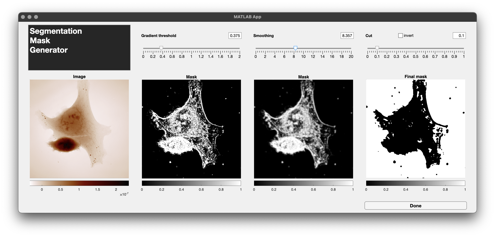

:orphan:

.. _lexique_rst:

lexique rst
___________

**Bold text**

*Italic text*

.. REFERENCE

Reference \ [#ACSP10_322]_

.. [#ACSP10_322] *Wavefront microscopy using quadriwave lateral shearing interferometry: from bioimaging to nanophotonics*, G. Baffou, **ACS Photonics** 10, 322-339 (2023)

.. DROP DOWN

Drop downs
----------

.. dropdown:: **Temperature processing** |subTitle|  Code to convert a wavefront distorsion image into a temperature map |/subTitle|
    :open:

    Un petit texte de dropdown ouvert

.. dropdown:: **Temperature processing** |subTitle|  Code to convert a wavefront distorsion image into a temperature map |/subTitle|

    Un petit texte de dropdown fermé

.. BLOC MATLAB

Bloc matlab
-----------

.. code-block:: matlab
    :linenos:

    % Block Matlab
    IM = QLSIprocess(Itf,IL);

.. code-block:: matlab

    % Block Matlab
    IM = QLSIprocess(Itf,IL);

.. BLOC HTML

Bloc html
---------

.. raw:: html
    
    
Bloc de texte html

    
 Voici une phrase entre balises p.

.. BLOC NOTE & WARNING

Colored boxes
-------------

.. note::
    Just a note. Tous les bloc types sont

    - attention
    - caution
    - danger
    - error
    - hint
    - important
    - note
    - tip
    - warning

.. FONCTIONS

Functions
---------

py:func environement: :py:func:`opendx0`

Matlab environment: :matlab:`a = [1 2 3]; b= 'toto'; % comment`

abbr environment: :abbr:`QLSI (quadriwave lateral shearing interferometry)`

Math environment :math:`(n,m)`

.. math::
    
    W = \mathcal{F}^{-1}\left[\displaystyle\frac{ \mathcal{F}(\partial_xW + i\partial_yW)}{2i\pi(k_x/N_x + ik_y/N_y)}\right]

Balise de code c: |c| code |/c|

Balise de code gr, pour |gr| mettre du texte en gris de couleur #888 et font-size:0.85em |/gr|    

Variable avec des doubles accents graves de part et d'autre: ``code``

|PhaseLAB|

|hr|

1|st|    

2|nd|

3|rd|

.. FIGURE

Figure
------

.. figure:: /images/opendx0.png
   :width: 400
   :align: center
   :target: http://guillaume.baffou.com/publications/063-Baffou-ACSPhotonics.pdf

   caption of the figure

Image
-----

.. Include an rst file

Include an rst file
-------------------

.. include:: /codeExamples/inSilicoSimu.rst

.. REFERENNE TO ANOTHER FILE

Reference to another file
-------------------------

:ref:`the lexic <lexique_rst>`

.. REFERENNE TO ANOTHER PAGE

Click on this page : :ref:`QLSIprocess <The_QLSIprocess_method>`

.. MOVIE

Include a movie
---------------

.. raw:: html

   <video width="512" height="512" autoplay loop muted>
      <source src="http://guillaume.baffou.com/movies/U2OS_low.mp4" type="video/mp4">
      Your browser does not support the video tag.
   </video>

|gr| U2OS cells |/gr|

.. lien html

Lien html
---------

Download at `github.com/baffou/PhaseLAB <https://github.com/baffou/PhaseLAB>`_.

.. TABS

TABS
----

.. tabs::

    .. tab:: Simple setup construction

        .. code-block:: matlab

            IL = Illumination(630e-9);                               % define the illumination
            MI = Microscope(100, 'Nikon', 'Silios_mono', 'PhaseLIVE');% define the microscope

    .. tab:: Advanced setup construction

        .. code-block:: matlab

            IL = Illumination(630e-9);                         % define the illumination
            Grating = CrossGrating(Gamma=39e-6,lambda0=630e-9);% define the cross-grating
            Cam = Camera('Zyla');                              % define the camera
            relayLensZoom = 1.11;                              % set the zoom of the relay-lens
            CGcam = CGcamera(Cam, Grating, relayLensZoom);     % define the QLSI camera
            OB = Objective(100, 1.3, 'Olympus')                % define the objective lens
            MI = Microscope(OB, 'Nikon', CGcam, 'PhaseLIVE');  % defines the microscope
